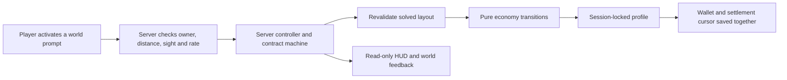

# One Button Factory: a bounded persistent economy

**Stage 3 implementation · Luau / Rojo / Wally · October 2026**

One Button Factory began as a four-socket arithmetic puzzle. The next engineering problem is preserving a solved machine, paying for time away, and moving interaction into a physical workshop without giving the client authority over money or results.

This is an implemented prototype with local automated verification. Live DataStore recovery and the new 3D phone experience still need integration testing; this case study makes no production, revenue or retention claim.

## The system boundary



The client presents status and native prompts. The server selects modules, validates arrangements, evaluates each clamped operation and calculates rewards. The only gameplay RemoteEvent command exposed in this stage is a bounded, read-only Sync request. A client cannot submit a balance, price, production rate, timestamp or solved answer.

World prompts have their own checks: matching workstation owner, active profile, living character, server-measured distance of at most eight studs, line of sight and action throttles. Hiding another player's prompts locally is a visual convenience; it is not the permission boundary. This follows [Roblox's guidance on validating client-triggered actions, including ProximityPrompt](https://create.roblox.com/docs/scripting/security/client-server-boundary).

## Ten hours away, at twenty percent production

The requested settlement rule is implemented directly:

```text
elapsed = clamp(server_now − saved_cursor, 0, 36,000)
offline = floor(saved_rate × min(0.20 × elapsed, 7,200))
```

At two coins per second, ten hours away awards 14,400 coins. Returning after twenty hours yields the same amount. A future saved timestamp yields zero and never moves backward; a newly reconciled account receives no invented historical earnings. Repeating settlement at the same cursor yields zero.

The following is an original excerpt from the implemented pure economy module. The surrounding `ready` check validates the account and server timestamp; `addCoins` enforces the wallet ceiling.

```luau
function api.settleOffline(data: Data, now: number): (number, string)
	ready(data, now)
	local previous = data.lastSettledAt
	local elapsed = if previous == 0 then 0 else math.clamp(now - previous, 0, 36000)
	local gross = math.floor(data.savedRate * math.min(0.20 * elapsed, 7200))
	local awarded = addCoins(data, gross)
	data.lastSettledAt = math.max(previous, now)
	return awarded, if previous > now then "Server clock is behind the saved cursor; no offline award." else "Offline settlement applied."
end
```

Coins and the settlement cursor change together without yielding, within one session-owned profile. This prevents reapplying an already persisted award to that persisted balance. It does **not** establish durable, exactly-once effects through every service outage: a crash before saving can roll back unsaved account changes. A save request is not treated as a durable acknowledgement. There are no external trades or paid purchase receipts in this stage.

Connected production uses server monotonic elapsed time, carries fractional coins and credits the old rate before an upgrade or first solve changes it. A defensive 60-second tick cap bounds recovery after a stalled server; excess stalled time is not credited as active production. The wallet is capped at one trillion coins, below integer precision limits.

## Saving a machine, not trusting a claim

Saved layouts are re-evaluated against authored contracts when loaded. Unknown modules, duplicates, locked-socket violations and incorrect outputs fail validation. A saved rate must agree with validated progression; a higher number in storage is not accepted automatically.

For this prototype, the saved best machine is ranked by `target / active_socket_count`, with a stable contract-ID tie-break. This is a transparent prototype convention, not a measured optimum for player enjoyment or factory throughput. The chosen layout is copied back into the workbench for a returning player.

Progression is deliberately small:

- Production rate: `2 + 0.2 × upgrade_level` coins per second after the first verified solve.
- Next upgrade price: `ceil(60 × 1.12^upgrade_level)` coins.
- Entitlement: three upgrades per distinct solved non-intro contract, capped at 30 in the schema.
- Current content: four non-intro contracts, so only 12 upgrades and 4.4 coins per second are reachable.
- A first non-intro solve grants a one-time family bonus. Repeating it cannot repeatedly claim that bonus.

The last contract cycles back to the introduction in persistent mode. The preserved disposable hook retains its original end state.

## Persistence and dependency choice

Wally pins `samuzen/profileservice@1.0.2`; Rojo maps it into ServerScriptService. The wrapper's normalized Lua source was compared with Mad Studio's upstream source on 29 October 2026 and matched. Its Apache 2.0 license is retained in the private project; no dependency code is republished here.

The owner explicitly requested ProfileService. Its [maintainer now recommends ProfileStore for new projects](https://github.com/MadStudioRoblox/ProfileService), so this is a documented legacy dependency choice, not a recommendation to adopt an unsupported library without review.

The adapter acquires a session lock before enabling the workshop. Its bounded 120-second loading window accommodates the pinned dependency’s recovery sequence rather than expiring before recovery can complete. Invalid data or a failed persistent store initialization stops play instead of creating an apparently saved temporary wallet. Profile loss revokes interaction and removes the session. Departure and shutdown release ownership; unresolved shutdown saves are reported rather than declared successful.

Studio defaults to explicit mock player profiles. An opt-in persistent Studio path uses a separate store name and checks service availability; published play uses the live store. The dependency may still perform its own Studio availability probe, so mock player profiles do not imply zero service requests.

## A physical workshop with ten asset families

The server generates a room shell, workbench, socket bases, machine housings, input hopper, output tray, product tokens, RUN-button housing, contract sign and showcase plinth. They use Parts, welded decoration, SurfaceGui labels and native ProximityPrompts. Tokens animate visually instead of depending on a physics conveyor.

Each player receives an isolated station. Native prompts handle selection and swapping; a compact safe-area HUD displays the contract and economy. The Stage 2 flat workbench remains available in a separate Rojo configuration for comparison. No external meshes, bespoke character rigs or purchased assets are required to test this migration.

## Verification and limits

The [verification index](notes/verification-index.md) records dated counts and scope. Automated checks exercise arithmetic, progression, replay boundaries, malformed saved accounts, controller selection and prompt policy. Strict analysis covers pure modules; syntax compilation covers the Roblox adapters. The generated place contains only the intended server adapter and World LocalScript, plus their modules and two remotes.

The new Stage 3 native session, two-player isolation in Studio, actual phone prompts/camera/rotation, live rejoin persistence and multi-server recovery remain unverified. A standalone mock-storage smoke script is prepared and syntax-compiled, but has not been executed. These are the next integration checks before treating the persistence layer as release-ready.

Product direction, scope and review by Yassein; implementation and testing developed with AI assistance. This public export contains curated original excerpts and engineering evidence, not the private source repository or participant records.

[Portfolio](README.md) · [Earlier hook prototype](CASE_STUDY_PROTOTYPING.md) · [Viewing and reuse notice](LICENSE)
