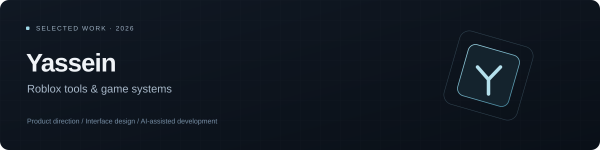

  

# Yassein

I’m building a portfolio around Roblox game systems, thoughtful interfaces and small projects with clear technical boundaries. My focus is turning a game or tool idea into a coherent product: defining the loop, simplifying the scope and testing what actually works.

I work with AI assistance for research, implementation and iteration. My role is product direction, requirements, design decisions and reviewing the results. The work below distinguishes implemented software from design proposals; it does not claim a shipped commercial Roblox game or unverified player and revenue results.

## Selected work

### Roblox discovery workspace

**Implemented local application · Python / FastAPI / SQLite / JavaScript**

A compact research interface that turns public game data into timestamped observations and a responsive card workspace. The engineering emphasis is on reliable imports, honest handling of missing information and preserving existing data during upgrades.

*A recreated UI study with fictional data; the case study explains its relationship to the working application.*

- Resolves game identities before fetching metrics.
- Separates unavailable data from valid zero values.
- Uses bounded requests, retry backoff and conservative rate limiting.
- Preserves observations through additive database migrations.
- Presents history and evidence without claiming access to private game analytics.

[Read the case study →](case-studies/discovery-workspace.md)

## How I approach development

**Start with the interaction.** Make the first useful action clear before expanding the feature list.

**Keep the scope small.** Prefer reusable systems and simple assets over an ambitious map that never becomes playable.

**Make claims testable.** Separate a working implementation, a measured result and an idea that still needs a prototype.

**Use AI transparently.** Treat generated output as work to inspect and test, not evidence that a feature is correct.

[Read the workflow notes →](notes/development-approach.md)

## Contact and permissions

Find me on [GitHub @voi0](https://github.com/voi0).

This repository is a public portfolio for viewing and evaluation. It is **not an open-source release**. Original material is all rights reserved, subject to GitHub’s terms, applicable law and any separately identified third-party rights. Please obtain permission before reuse. See [LICENSE](LICENSE).
