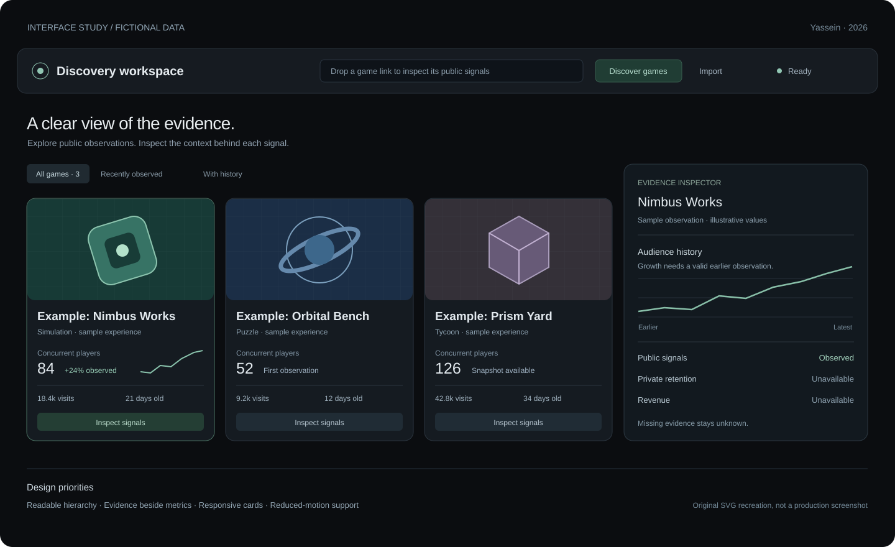
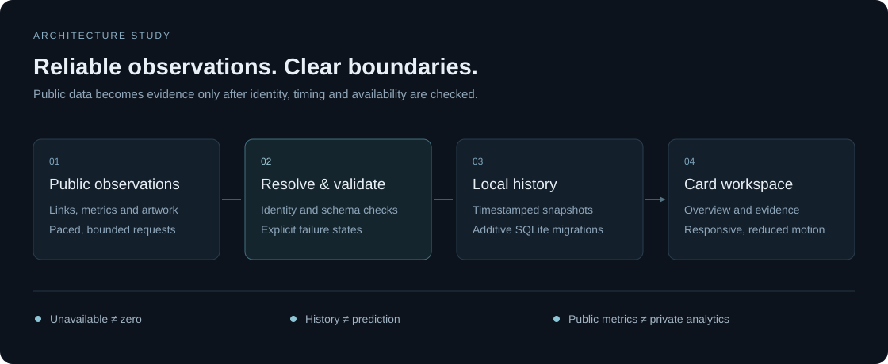

# Roblox discovery workspace

**Implemented local application · October 2026**

Public game data is useful only when the application keeps track of where it came from, when it was observed and what it cannot tell us. This project explores that boundary through a local research dashboard.

My role was product direction, requirements and iterative interface feedback. Implementation, debugging and verification were AI-assisted. This is a software case study, not a released Roblox experience.

*Original UI recreation based on the implemented interface direction. All names, artwork and values are fictional. Private workflows are omitted. This is a design illustration, not a production screenshot.*

*This is a newly drawn, simplified architecture illustration. It is not a screenshot, live dataset or performance benchmark.*

## The problem

A game link contains a place identifier, while some public metric endpoints require a different experience identifier. Requests can fail, responses can be incomplete and the same game can appear more than once. A pleasant interface alone cannot make those observations reliable.

The application therefore needs to preserve a simple distinction: **observed, unavailable and not yet checked are different states**.

## Design decisions

### Resolve identity at the boundary

Inputs accept links or identifiers. The import layer resolves the correct identity before fetching metrics, validates the response and deduplicates records. Errors remain visible instead of becoming apparently successful empty results.

### Store observations, not just the latest number

SQLite holds timestamped metric snapshots. Historical observations support small audience charts and comparisons between scans. Repeated timestamps do not manufacture growth. Additive migrations preserve earlier records when optional fields are introduced.

### Keep public evidence within its limits

Public audience counts and reactions can support exploratory comparisons. They cannot establish a game's private revenue or retention. The interface leaves unavailable information unknown rather than converting it to zero or presenting an estimate as a fact.

### Treat network failure as normal

The client paces requests, bounds retry and enrichment budgets, responds conservatively to rate limits and keeps certificate verification enabled. An optional source failure should not erase already validated observations.

### Make the interface explain the data

A responsive card board gives an overview; an inspector holds the evidence and history. Artwork, sparklines and restrained motion support orientation. Reduced-motion preferences and narrow screens are part of the interface design.

## Verification and limits

The local verification record dated 22 October 2026 reports 546 passing automated tests and two skipped opt-in live-network checks. Regression cases cover malformed identifiers, duplicate observations, missing fields, request failures, rate limits, unsafe image URLs and migrations. The same record documents a browser walkthrough using disposable data, including layouts from 360 to 1440 pixels. These are dated development results, not a claim that the full live pipeline has been retested on every network.

These checks establish specific software behaviors. They do not establish real-world market prediction accuracy or a profitable game-selection strategy. Complete live-network ingestion remains a separate validation step.

The public case study deliberately publishes a high-level explanation and an original diagram. It does not include operational source, datasets, private configuration, account information or third-party procedures.

## Stack

Python · FastAPI · HTTPX · SQLite · JavaScript · HTML/CSS · pytest

[Back to portfolio](../README.md)
